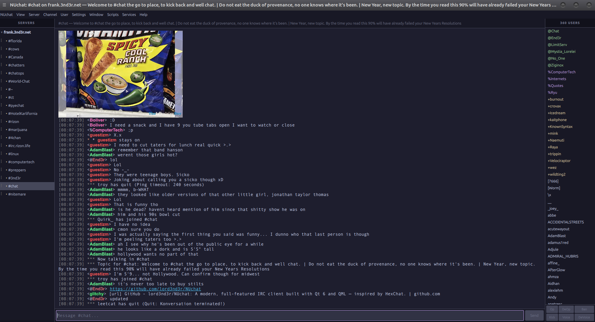

# NUchat

A modern, full-featured IRC client built with Qt 6 and QML — inspired by HexChat.


See [CHANGELOG.md](CHANGELOG.md) for what's new in each release.

---

## Screenshot



---

## Features

- **Multi-server** — connect to multiple networks simultaneously
- **SSL/TLS** on all connections with **per-network SASL** (PLAIN/EXTERNAL) and **NickServ auto-identify**
- **25 built-in themes** — HexChat Dark, Monokai, Dracula, Nord, Gruvbox, Catppuccin, and more
- **mIRC color codes** — foreground (palette and hex), bold, italic, underline, and strikethrough, plus input shortcuts. Background color codes are parsed and then dropped when the message is turned into HTML.
- **Clickable URLs** with inline image previews (off by default; enable under Preferences → URL Handlers)
- **DCC file transfer** — send and receive with progress, ETA, and speed. Offers to loopback, unspecified, link-local, and other non-unicast addresses are rejected. Receives use the configured proxy, or they are refused when that proxy cannot be applied. An active send is refused while a proxy is configured, because it listens for a direct connection.
- **Nick list** with multi-select (Ctrl+click, Shift+click) and mode buttons (Op, DeOp, Ban, Kick, Voice, DeVoice)
- **Tab nick-completion** with cycling
- **Input history** — Up/Down arrow keys recall previous messages
- **Paste flood protection** — confirmation dialog when pasting multiple lines
- **Spell checker** — Hunspell. Dictionaries are searched in `DICPATH`, next to the application (`hunspell/` and `dictionaries/`), the usual Linux paths (`/usr/share/hunspell`, `/usr/share/myspell/dicts`), Homebrew locations on macOS, and the user data directory. `en_US` and `en-US` names both match.
- **Auto-focus input** — typing anywhere in the window goes to the input bar
- **Smart chat area** — auto-scroll, jump-to-bottom button, and "new messages" marker line
- **Collapsible event groups** — groups multiple joins/parts/quits into a single clickable summary line
- **Lag meter** — visual PING/PONG RTT indicator in the status bar
- **Scrollback** — loads last 200 lines from logs when rejoining a channel
- **Channel logging** to `~/.config/NUchat/NUchat/logs/` on Linux, with a 10 MB rotation that keeps one `.log.1` backup
- **Built-in commands and aliases** — see [docs/COMMANDS.md](docs/COMMANDS.md)
- **Services menus** — NickServ, ChanServ, OperServ, HostServ, MemoServ, BotServ
- **Right-click context menus** on nicks and links
- **10 pre-configured networks** (Libera.Chat, OFTC, EFnet, DALnet, Rizon, and more)
- **Per-network identity** override (nick, username, real name)
- **Channel modes on join** — displays mode string when entering a channel
- **Dynamic title bar** — shows channel, server, and topic (like HexChat)
- **C++ plugin API**, **Python scripting**, and **Lua scripting** — a HexChat-style subset (see the docs for what is actually implemented)
- **Migrate from HexChat** — first-launch wizard imports your scripts, server list, and identity
- **ZNC bouncer** support
- **Proxy support** — SOCKS5 and HTTP CONNECT. SOCKS4 is refused (Qt has no SOCKS4 client). A proxy with no host or an invalid port is refused instead of connecting directly.
- **Desktop integration** — `.desktop` file, SVG icon, system tray, notifications, `make install` support

---

## Quick Start

### Dependencies

**Ubuntu/Debian:**
```
sudo apt install build-essential cmake pkg-config \
  qt6-base-dev qt6-declarative-dev \
  qml6-module-qtquick-controls qml6-module-qtquick-layouts \
  qml6-module-qtquick-templates \
  libgl1-mesa-dev \
  python3-dev liblua5.4-dev libhunspell-dev
```

Python, Lua, and Hunspell are optional. CMake disables the matching feature when the development files are missing. On current Debian and Ubuntu, Qt Quick Controls ships in `qt6-declarative-dev`; there is no separate `qt6-quickcontrols2-dev` package. `find_package(Python3)` uses whichever Python 3 development files it finds first, and the embedded interpreter is tied to that ABI.

**Fedora:**
```
sudo dnf install cmake gcc-c++ \
  qt6-qtbase-devel qt6-qtdeclarative-devel qt6-qtquickcontrols2-devel \
  mesa-libGL-devel
```

**Arch:**
```
sudo pacman -S cmake qt6-base qt6-declarative qt6-quickcontrols2
```

### Build & Run

```bash
git clone https://github.com/lord3nd3r/NUchat.git
cd NUchat
mkdir build && cd build
cmake .. -DCMAKE_BUILD_TYPE=Release
make -j$(nproc)
./src/nuchat
```

On Make and Ninja, omitting `-DCMAKE_BUILD_TYPE` also selects Release. Pass `Debug` for an unoptimized build. Visual Studio and Xcode are multi-config generators: they ignore `CMAKE_BUILD_TYPE` and take `--config Release` (or `Debug`) on the build command.

### Install (optional)

```bash
sudo make install
```

Uses GNUInstallDirs — installs binary, desktop file, icon, and plugin/script directories. Uninstall with `sudo make uninstall`.

### Continuous integration

| Workflow | Qt | Tests |
|----------|----|-------|
| Linux (`ubuntu-latest`) | Distro Qt 6 packages | `ctest` |
| Linux ASan/UBSan | Distro Qt 6, Python disabled | `ctest` under AddressSanitizer and UndefinedBehaviorSanitizer |
| Windows (`windows-2022`) | Qt 6.5.3 via aqtinstall | `ctest -C Release` |
| macOS (`macos-15`) | Qt 6.8.3 via aqtinstall | `ctest` |
| FreeBSD (VM on `ubuntu-latest`) | Ports Qt 6 | `ctest` |
| Release (published release or `v*` tag) | The four platform jobs above | Same `ctest` runs, then uploads the four zip assets |

Windows stays on Qt 6.5.3 and `windows-2022` because newer MSVC standard-library headers removed an API that Qt 6.5.3 still uses. macOS stays on Qt 6.8.3 because that release's OpenGL find-module still references the AGL framework, which the Xcode 26 SDK removed.

Publishing a GitHub Release, or pushing a `v*` tag for a release that already exists, runs the Release workflow. It reuses the Linux, FreeBSD, macOS, and Windows jobs and uploads `nuchat-linux.zip`, `nuchat-freebsd.zip`, `nuchat-macos.zip`, and `nuchat-windows-installer.zip`. See [Releasing](docs/RELEASING.md).

---

## Configuration

| Path | Purpose |
|------|---------|
| `~/.config/NUchat/NUchat.conf` | Settings (theme, window geometry, networks, identity). Password fields are blank when the OS keychain is in use |
| `~/.config/NUchat/NUchat/logs/` | Channel logs. Directory, enable, timestamps, private messages, and per-channel files follow Preferences. Rotated `.log.1`–`.log.5`. Control characters and mIRC codes stripped |
| `~/.config/NUchat/scripts/` | Python and Lua scripts |
| `~/.cache/NUchat/images/` | Cached inline image previews |

### Passwords and the OS keychain

Server `PASS`, SASL, NickServ, ZNC, and proxy passwords are stored in the OS keychain (libsecret on Linux, Keychain on macOS, Credential Manager on Windows) through [QtKeychain](https://github.com/frankosterfeld/qtkeychain). On the first launch after upgrading, existing passwords are copied out of `NUchat.conf` and the copies in the file are cleared. Every other setting in that file is left as it was.

QtKeychain is optional at build time:

| Platform | Package |
|----------|---------|
| Debian / Ubuntu | `qtkeychain-qt6-dev` |
| Fedora | `qt6-qtkeychain-devel` |
| FreeBSD | `qtkeychain-qt6` |
| macOS | QtKeychain built for Qt 6 (`brew` / a source build) |
| Windows | QtKeychain built for the same Qt 6 used to compile NUchat |

If CMake does not find Qt6Keychain, the build still succeeds and passwords stay in `NUchat.conf` as plaintext — the same place they lived in older versions. The CMake warning names the missing package. A keychain write that fails at runtime (no secret service, locked keychain, denied prompt) also leaves the plaintext value in `NUchat.conf`, so a failed migration cannot drop a saved password.

`/msg NickServ IDENTIFY` (and the same kind of command to ChanServ, OperServ, Q, X, and the other service bots: `AUTH`, `REGISTER`, `GHOST`, `SET PASSWORD`, …) is still sent to the server, but the password is replaced with `***` in the chat buffer, the channel log, and the raw log. `PASS`, SASL `AUTHENTICATE` payloads, and `OPER` passwords are redacted there too.

### Self-signed / untrusted SSL certificates

If your IRC server uses a self-signed certificate or one where the hostname doesn't match (common on self-hosted servers), you'll see an SSL error and the connection will be refused. To allow it:

1. Open **Settings → Preferences → Connection**
2. Check **"Accept self-signed / untrusted SSL certificates"**
3. Reconnect

The preference is global. When it is checked, the handshake continues for self-signed certificates, hostname mismatches, and untrusted issuer chains. Expired certificates and every other TLS error still abort the connection. The default is off, and then any TLS error aborts the connection.

Outbound IRC lines have CR, LF, and NUL removed before they are sent. Debug logs redact `PASS`, `OPER`, SASL `AUTHENTICATE` payloads, and NickServ `IDENTIFY`. Inline image fetches use the IRC proxy or they are skipped, and they do not follow a redirect onto a private or special-use address.

### Logging

Logs are written under the directory from Preferences (`log/directory`). A leading `~` is expanded. When that setting is empty, the logger uses Qt's application config location plus `/logs` (`~/.config/NUchat/NUchat/logs/<network>/<channel>.log`). `log/enable` turns logging off. `log/privateMessages` skips queries when it is off; the server tab is still written. `log/perChannel` off folds every channel of a network into `messages.log`. `log/timestamps` off writes `[type] message` with no time prefix. `log/formatIndex` is stored by the preferences page and is not read by the logger.

Each file rotates at 10 MB and keeps `.log.1` through `.log.5`. Lines strip C0 controls, ANSI escapes, and mIRC color codes so one message stays one line. Writes are flushed and `fsync`'d, and new log files and directories are owner-only. A name of `.` or `..` stays inside the log directory. Trailing dots are removed so Windows stores the same path the logger opens.

## Downloads

Pre-built binaries and installers for **NUchat 1.6.1** are available on the [GitHub Releases page](https://github.com/lord3nd3r/NUchat/releases/tag/v1.6.1).

| Platform   | Archive                        | Approx. Size | Contents |
|------------|--------------------------------|--------------|----------|
| Linux      | `nuchat-linux.zip`             | 480 KiB      | Single `nuchat` executable (extract + `chmod +x ./nuchat`) |
| FreeBSD    | `nuchat-freebsd.zip`           | 420 KiB      | Single `nuchat` executable |
| macOS      | `nuchat-macos.zip`             | 54 MiB       | `nuchat-macos.dmg` — open the DMG and drag NUchat to Applications |
| Windows    | `nuchat-windows-installer.zip` | 21 MiB       | `NUchat_1.6.1_Windows_x64.exe` (NSIS installer) |

**Direct download links** (or visit the [Releases page](https://github.com/lord3nd3r/NUchat/releases/tag/v1.6.1) for all assets and release notes):

- Linux: https://github.com/lord3nd3r/NUchat/releases/download/v1.6.1/nuchat-linux.zip
- FreeBSD: https://github.com/lord3nd3r/NUchat/releases/download/v1.6.1/nuchat-freebsd.zip
- macOS: https://github.com/lord3nd3r/NUchat/releases/download/v1.6.1/nuchat-macos.zip
- Windows: https://github.com/lord3nd3r/NUchat/releases/download/v1.6.1/nuchat-windows-installer.zip

Older / CI builds are still available from the GitHub Actions artifacts if needed.

---

## Windows Build (for developers)

If you prefer to build locally on Windows:

**Local build steps (recommended for testing):**

1. Install **Visual Studio 2022** with the "Desktop development with C++" workload.
2. Download and install **Qt 6.8.x** for **MSVC 2022 64-bit** from [qt.io](https://www.qt.io/download-open-source) (open source version is fine). The Windows CI job is different: it installs Qt 6.5.3 on `windows-2022`, because a newer MSVC standard library no longer provides an API that Qt 6.5.3's headers use. Local builds should stay on 6.8.x.
3. Add the Qt bin directory to your PATH (e.g. `C:\Qt\6.8.3\msvc2022_64\bin`).
4. Open **Developer Command Prompt for VS 2022**.
5. In the project directory:
   ```cmd
   mkdir build && cd build
   cmake .. -A x64
   cmake --build . --config Release
   ```
6. The executable is `build\src\Release\nuchat.exe`.

To bundle the Qt DLLs, run `windeployqt --qmldir ..\qml --no-translations build\src\Release\nuchat.exe`.

**Note:** The Windows CI job passes `-DCMAKE_DISABLE_FIND_PACKAGE_Python3=ON`, so that build has no Python scripting. A local Windows build enables Python when the development libraries are found. Lua is enabled when Lua is found. A C++ plugin is loaded only when it embeds `Q_PLUGIN_METADATA` for `com.nuchat.PluginInterface` (see [docs/PLUGINS.md](docs/PLUGINS.md)). HexChat migration also works.

See `CMakeLists.txt` and `src/CMakeLists.txt` for the cross-platform setup. PRs welcome for improvements.


## Migrating from HexChat

If HexChat data is detected in `~/.config/hexchat/` on first launch, NUchat will offer to import:

| What | Source |
|------|--------|
| Python & Lua scripts | `~/.config/hexchat/addons/*.py` / `*.lua` |
| Server/network list | `~/.config/hexchat/servlist.conf` |
| Nick, username, realname | `~/.config/hexchat/hexchat.conf` |

You can also run the wizard later via **Settings → Preferences → Scripts → Open Migration Wizard**.

Existing scripts and networks in NUchat are never overwritten.

---

## Themes

25 themes available via **Settings > Themes** or the Next/Previous Theme menu items:

HexChat Dark (default), Monokai, Solarized Dark/Light, Dracula, Nord, Gruvbox Dark/Light, One Dark/Light, Catppuccin Mocha/Latte, Tokyo Night, Material Dark, Cyberpunk, Retro Green, Retro Amber, Zenburn, Ayu Dark, GitHub Dark, Midnight Blue, Rose Pine, Everforest Dark, Ice, High Contrast

---

## Documentation

| Document | Contents |
|----------|----------|
| [Commands](docs/COMMANDS.md) | Built-in IRC commands and aliases |
| [Menus & Dialogs](docs/MENUS.md) | Menu bar reference, right-click menus, and dialog descriptions |
| [Scripting API](docs/SCRIPTING.md) | Python and Lua scripting reference (HexChat-compatible) |
| [Plugin API](docs/PLUGINS.md) | C++ plugin interface and build instructions |
| [Releasing](docs/RELEASING.md) | How the four release archives are built and uploaded |
| [Third-party notices](THIRD-PARTY.md) | Licenses for Qt, Python, Lua, Hunspell, and related notes |

---

## Project Structure

```
NUchat/
├── src/                    C++ backend
│   ├── main.cpp            Entry point
│   ├── IrcConnection.*     IRC protocol (QSslSocket, CAP LS 302, SASL)
│   ├── IRCConnectionManager.*  Multi-server management, command dispatch
│   ├── MessageModel.*      Chat messages, IRC→HTML, image embeds, nick colors
│   ├── Logger.*            Channel logging
│   ├── Version.h.in        Version header template. CMake writes Version.h from PROJECT_VERSION
│   └── ...                 ThemeManager, Settings, ScriptManager, PluginManager
├── qml/                    QML UI (21 files)
│   ├── main.qml            Main window (sidebar, chat, nick list, menus)
│   ├── ThemeManager.qml    25 built-in themes (50+ color properties each)
│   ├── NetworkListDialog.qml  Network manager with drag-and-drop reorder
│   └── ...                 Dialogs (preferences, DCC, channel list, and others)
├── plugins/                C++ plugin directory
├── scripts/                Example Python, Lua, and JavaScript scripts
├── resources/              Icons, .desktop file, theme JSON
├── tests/                  Unit tests
└── docs/                   Extended documentation
```

---

## Plugins & Scripts

### C++ Plugins

Implement `PluginInterface` (see `src/PluginInterface.h`) as a `QObject` with `Q_PLUGIN_METADATA(IID "com.nuchat.PluginInterface")`, and compile it as a shared library. The loader skips any library whose embedded IID is not `com.nuchat.PluginInterface`. On startup NUchat scans the Preferences plugin directory, `plugins/` next to the executable, `<build>/plugins` for an in-tree build, `${CMAKE_INSTALL_LIBDIR}/nuchat/plugins` after install, and `~/.config/NUchat/plugins`. The sample `plugins/exampleplugin/` CMake file writes the library to `${CMAKE_BINARY_DIR}/plugins`. See [docs/PLUGINS.md](docs/PLUGINS.md).

### Python and Lua scripts

Place `.py` and `.lua` files in `~/.config/NUchat/scripts/`. Both engines load that directory on startup. See `scripts/example.py` and [docs/SCRIPTING.md](docs/SCRIPTING.md).

A separate JavaScript loader (`ScriptManager`) loads `*.js` from the in-tree `scripts/` directory on a dev build, `<prefix>/share/nuchat/scripts` after install, `scripts/` next to the executable, and `~/.config/NUchat/scripts/`. It is not the HexChat API. `scripts/hello.js` defines `onMessage` and is called for `PRIVMSG` and `NOTICE` text. See [docs/SCRIPTING.md](docs/SCRIPTING.md).

---

## TODO

### Planned Features
- **`echo-message` CAP** — Server echoes your messages back with proper timestamp
- **`account-notify` / `extended-join`** — Show account info in join messages
- **SASL SCRAM-SHA-256** — Modern SASL mechanism
- **Detach/attach tabs** — Float channel tabs into separate windows
- **AppImage / Flatpak / .deb packaging**

Already in the client, and previously listed here: per-network auto-join (the Autojoin field in the Network List dialog), channel-list user counts, topics, search, and a minimum-user filter, size-based log rotation (`.log.1` through `.log.5`), and the Logging preferences for enable, directory, timestamps, private messages, and per-channel files.

---

## License

Licensed under the [GNU General Public License v3.0](LICENSE). Notes on Qt, Python, Lua, Hunspell, themes, and icons are in [THIRD-PARTY.md](THIRD-PARTY.md).
